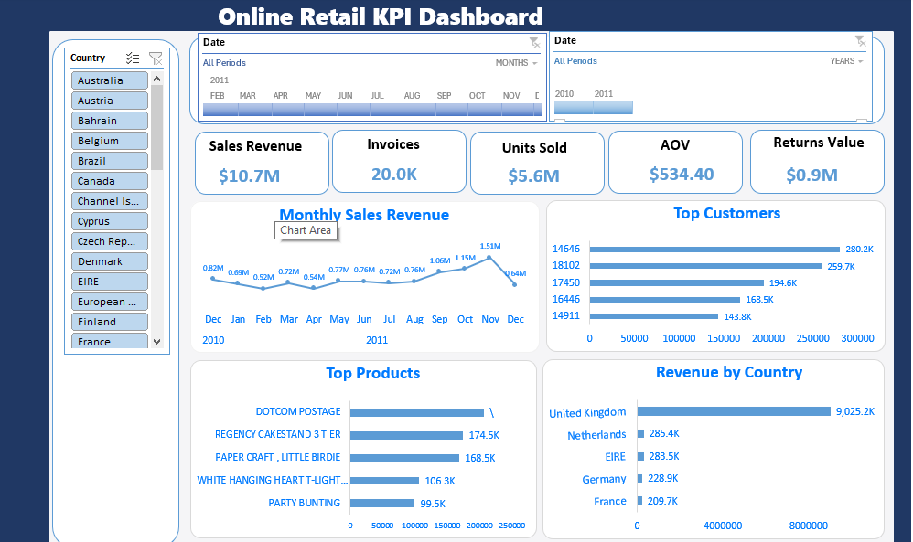
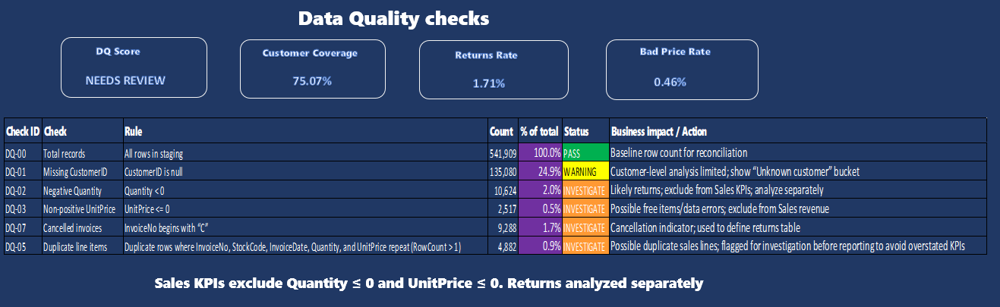
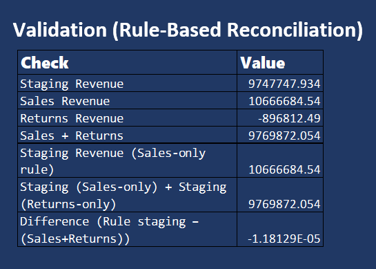

# Online Retail KPI Reporting (Excel + Power Query)

**Type:** Public Dataset — Portfolio Demonstration  
**Dataset:** UCI Machine Learning Repository — Online Retail (UK e-commerce transactions)

This project shows how I turn a raw transaction export into **trusted KPI reporting** by applying data quality checks, clear reporting rules (sales vs returns), and validation before building a dashboard.

---

## Business goal
Build a refreshable KPI reporting view that helps answer:
- What is total sales revenue and how is it trending by month?
- Which countries, products, and customers drive revenue?
- How much do returns/cancellations impact reporting?
- Can we trust the KPIs (data quality + reconciliation)?

---

## Reporting rules (important)
- **Sales KPIs exclude:** `Quantity ≤ 0` and `UnitPrice ≤ 0`
- **Returns/Cancellations:** analyzed separately
- Customer-level analysis is limited where `CustomerID` is missing (tracked in DQ report)

---

## Data quality checks included
The Data Quality report documents and quantifies:
- Missing `CustomerID`
- Negative `Quantity` (returns)
- `UnitPrice ≤ 0` (free items / data errors)
- Cancelled invoices (`InvoiceNo` begins with **"C"**)
- Duplicate line items (InvoiceNo + StockCode + InvoiceDate + Quantity + UnitPrice)

---

## Validation / reconciliation
I validated KPI logic by reconciling totals between:
- staging extract totals (under the reporting rules)
- `fact_sales` + `fact_returns`

Difference is near zero (rounding only), confirming the reporting rules are consistent.

---

## Files in this repository
- `UCI Online Retail.xlsx` — source dataset file
- `dashboard.png` — dashboard preview
- `dq_checks.png` — data quality checks summary
- `validation.png` — rule-based reconciliation proof

---

## Visuals

### Dashboard

### Data Quality Checks

### Validation (Rule-Based Reconciliation)

---

## Tools used
- Excel (PivotTables, PivotCharts, slicers/timeline)
- Power Query (data cleaning and transformation)

---

## Author
**Zehroz Shahzad**  
LinkedIn: https://www.linkedin.com/in/zehrozshahzad
